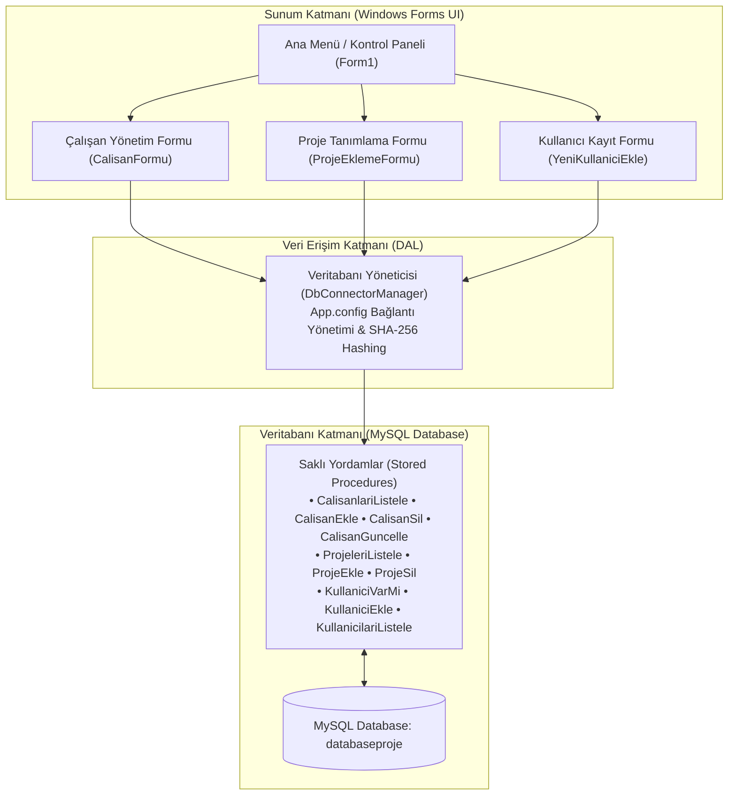

# Proje ve Çalışan Yönetim Sistemi

[](https://dotnet.microsoft.com/)
[](https://www.mysql.com/)
[](https://learn.microsoft.com/dotnet/desktop/winforms/)
[](LICENSE)

C# Windows Forms ve MySQL kullanılarak geliştirilmiş; çalışan, proje ve kullanıcı yönetimini tek bir merkezde toplayan masaüstü kurumsal yönetim uygulamasıdır. Proje, tüm veritabanı operasyonlarını **MySQL Saklı Yordamları (Stored Procedures)**, SHA-256 parola özetleme ve parametrik sorgular üzerinden yürüterek yüksek veri güvenliği ve SQL Injection koruması sağlar.

---

## Mimari Yapı

Uygulama, sorumlulukların ayrıldığı katmanlı bir yaklaşımla (Layered / N-Tier Architecture) tasarlanmıştır:



---

## Temel Özellikler

- **Çalışan Yönetimi (Tam CRUD & Otomatik Veri Bağlama):**
  - Firma personelini unvan ve pozisyon bilgileriyle sisteme kaydetme.
  - Tablo üzerinden personel seçildiğinde form alanlarının otomatik doldurulması (`SelectionChanged`).
  - Var olan çalışanların pozisyon ve ad-soyad bilgilerini güncelleme.
  - Yanlışlıkla silinmeleri önleyen kullanıcı onaylı (`DialogResult.YesNo`) silme mekanizması.
  - Verileri dinamik olarak `DataGridView` üzerinde anlık listeleme ve tam satır seçimi (`FullRowSelect`).
- **Proje Takip ve Planlama:**
  - Proje adı, başlangıç ve bitiş tarihlerini belirleyerek yeni proje oluşturma.
  - Başlangıç ve bitiş tarihleri için mantıksal doğrulama (başlangıç tarihi bitiş tarihinden sonra olamaz).
  - Projeleri yöneticileriyle birlikte listeleme.
- **Güvenli Kullanıcı Kayıt & Doğrulama:**
  - `System.Security.Cryptography.SHA256` ile parolaların veritabanında güvenli özet (hash) olarak saklanması.
  - Şifreleme karakter maskelemesi (`UseSystemPasswordChar`).
  - Regex tabanlı e-posta format doğrulaması (`IsValidEmail`).
  - Parola ve parola tekrarı eşleşme kontrolü.
  - Veritabanı düzeyinde tekil kullanıcı adı ve e-posta kontrolü (`KullaniciVarMi` Stored Procedure).
- **Güvenli Veri Erişimi:**
  - `DbConnectorManager` üzerinden merkezi bağlantı ve kaynak yönetimi (`using` blokları ile otomatik connection disposal).
  - Hassas veritabanı şifrelerinin kod içerisinden temizlenip `App.config` dosyasında yapılandırılması.
  - Parametrik saklı yordam (Stored Procedure) kullanımı ile tam SQL Injection koruması.

---

## Proje Dizin Yapısı

```text
├── database/
│   └── schema.sql              # Tablolar, ilişkiler, saklı yordamlar ve seed veriler
├── ProjeYonetimSistemi/
│   ├── CalisanFormu.cs         # Personel yönetim arayüzü ve CRUD olayları
│   ├── ProjeEklemeFormu.cs     # Proje oluşturma ve listeleme arayüzü
│   ├── YeniKullaniciEkle.cs    # Kullanıcı kayıt, SHA-256 ve doğrulama arayüzü
│   ├── Form1.cs                # Ana gösterge paneli ve form navigasyonu
│   ├── DbConnectorManager.cs   # MySQL ADO.NET veri erişim ve şifreleme yöneticisi
│   ├── App.config              # Veritabanı bağlantı dizesi konfigürasyonu
│   ├── packages.config         # NuGet paket bağımlılıkları (MySql.Data vb.)
│   └── ProjeYonetimSistemi.csproj
├── ProjeYonetimSistemi.sln     # Visual Studio çözüm dosyası
├── .gitignore                  # Visual Studio ve geçici derleme dosyaları filtreleri
├── LICENSE                     # MIT Açık Kaynak Lisansı
└── README.md
```

---

## Kurulum ve Çalıştırma

### 1. Gereksinimler
- **Visual Studio 2019 / 2022** (.NET masaüstü geliştirme iş yükü)
- **.NET Framework 4.7.2** veya üzeri
- **MySQL Server 8.x** veya **MariaDB** (veya XAMPP / WampServer)

### 2. Veritabanının Kurulması
1. MySQL Workbench veya phpMyAdmin arayüzünü açın.
2. Proje dizinindeki [`database/schema.sql`](database/schema.sql) dosyasını çalıştırın:
   ```sql
   source /dosya/yolu/database/schema.sql;
   ```
   *Bu betik `databaseproje` veritabanını, tabloları, saklı yordamları ve başlangıç örnek verilerini otomatik olarak oluşturacaktır.*

### 3. Bağlantı Ayarlarının Yapılması
`ProjeYonetimSistemi/App.config` dosyasını açarak kendi yerel MySQL sunucu kullanıcı adı ve şifrenizi girin:
```xml
<connectionStrings>
    <add name="DefaultConnection" 
         connectionString="Server=localhost;Database=databaseproje;Uid=root;Pwd=SIFRENIZ;" 
         providerName="MySql.Data.MySqlClient" />
</connectionStrings>
```

### 4. Projeyi Derleme ve Çalıştırma
1. `ProjeYonetimSistemi.sln` çözüm dosyasını Visual Studio ile açın.
2. NuGet paketlerinin geri yüklenmesi için projeye sağ tıklayıp **Restore NuGet Packages** seçeneğini seçin.
3. **F5** veya **Start** tuşuna basarak projeyi başlatın.

---

## Lisans

Bu proje [MIT Lisansı](LICENSE) altında lisanslanmıştır.
